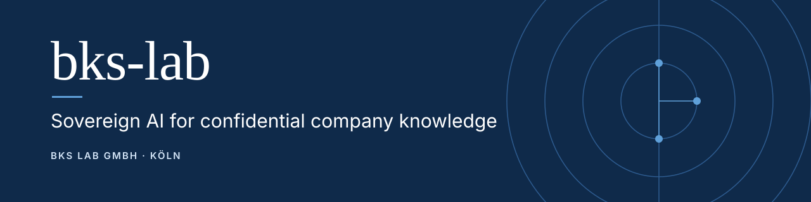

---

## About

BKS-Lab makes confidential company knowledge searchable, analysable and automatable. The AI runs locally or self-hosted in your own infrastructure, so data and models stay in your house.

We work for companies that want to use AI but first have to settle data protection, cloud dependency or the EU AI Act.

BKS-Lab is a small team of specialists. The company is **BKS Lab GmbH**, Köln (formerly Boiman Kupermann Solutions GmbH).

## How we work

The path is modular. It starts with a fixed-price readiness check, continues with a clearly scoped pilot and ends in production and operations. Between the stages there is a contractual exit point.

| Stage | What happens |
|:---|:---|
| **Sovereign AI Assessment** | Use cases, data and system landscape, sovereignty risks, cloud versus self-hosted, target architecture, pilot proposal |
| **Pilot** | Either a Knowledge Base Pilot (a limited document corpus, indexed and searched locally) or a Local LLM and Automation Pilot (one concrete process handled by a self-hosted model) |
| **Production and operations** | Hardening, integration, roles, security, update and support model |

Details: [Services](https://bks-lab.com/leistungen/) (German) and [English site](https://bks-lab.com/en/).

## Focus areas

- **Knowledge Automation:** full-text and semantic search, fuzzy search, knowledge graph, entity recognition, RAG and local LLMs, as one engine. See the [Sovereign Knowledge Engine](https://bks-lab.com/produkt/).
- **Self-Hosted LLM Enablement:** model and hardware assessment, inference architectures, on-premise, air-gapped or sovereign EU cloud deployment.
- **Quality and Automation:** test and process automation where local AI enters software development, operations and document-driven processes, for example Peppol e-invoicing flows and log analysis.

We also run [trainings](https://bks-lab.com/schulungen/) for leadership teams, beginners and advanced AI users.

## We use what we recommend

Our daily work runs on **BKS open-bridge**. We published the core as open source under the MIT licence. We measure models before we recommend them, and we publish the measurements together with their limits.

| Repository | What it is |
|:---|:---|
| [open-bridge](https://github.com/bks-lab/open-bridge) | A git repository of markdown and YAML that a coding agent (Claude Code, Codex, Copilot CLI) reads at the start of every session, so it picks up where you stopped. MIT. [Live demo and docs](https://bks-lab.github.io/open-bridge/), [blog post](https://bks-lab.com/en/blog/open-bridge-open-source/) |
| [lab-bench](https://github.com/bks-lab/lab-bench) | A repeatable test bench for local models on one RTX 4090: CV matching, routing, extraction, compared with the hosted decision model Jev. Results on [Hugging Face](https://huggingface.co/bks-lab), write-up in the [blog](https://bks-lab.com/en/blog/pruefstand-auf-hugging-face/) |
| [bks-news](https://github.com/bks-lab/bks-news) | AI-generated news briefings as a static site |

## Lab and blog

- [BKS Labor](https://bks-lab.com/labor/): experiments, demos and measurements from our own operations, including an [A2A chat](https://bks-lab.com/labor/a2a-chat/) with our public knowledge agent.
- Recent articles: [Measure first, then recommend: our test bench on Hugging Face](https://bks-lab.com/en/blog/pruefstand-auf-hugging-face/), [Jev against local models](https://bks-lab.com/en/blog/jev-gegen-lokale-modelle/), [BKS open-bridge as open source](https://bks-lab.com/en/blog/open-bridge-open-source/).

## Team

| Person | Role |
|:---|:---|
| Michael Boiman | CTO, Principal Engineer |
| Lior Boiman | Managing Director, Business and Requirements |
| Michael Kupermann | Market Lead, Strategy |
| Axel von Dielingen | Product, Delivery Lead |
| Florian Hegenbarth | Software Developer and E-Invoice Specialist |

More on the [team page](https://bks-lab.com/team/).

## Contact

BKS Lab GmbH, Im Zollhafen 12, 50678 Köln
[info@bks-lab.com](mailto:info@bks-lab.com) · [bks-lab.com](https://bks-lab.com) · [LinkedIn](https://www.linkedin.com/company/bks-lab)
